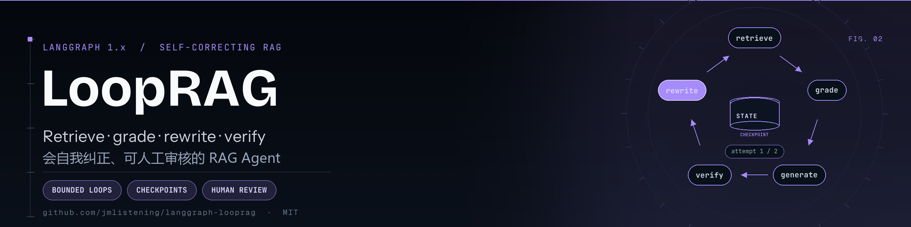
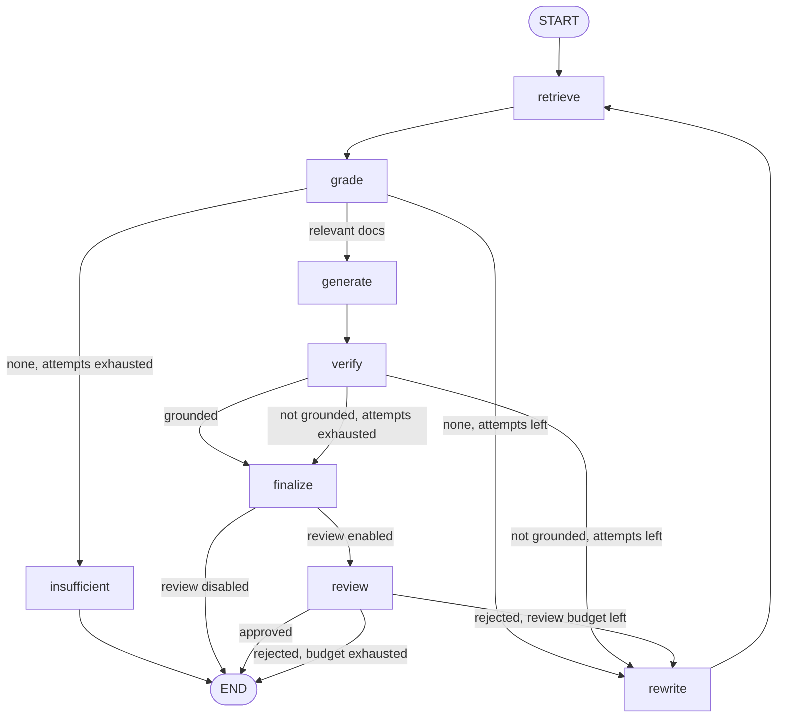

# LoopRAG

<p align="center">
  
</p>

[简体中文](README.zh-CN.md) · English

[](https://github.com/jmlistening/langgraph-looprag/actions/workflows/ci.yml)
[](LICENSE)
[](https://www.python.org/downloads/)
[](https://github.com/langchain-ai/langgraph)
[](#quickstart)

**A self-correcting RAG agent loop — LangGraph 1.x, query rewriting, relevance
grading, answer verification, bounded retries, human-in-the-loop review.**

LoopRAG answers questions over a small local corpus, but it does not stop at
"retrieve once, generate once". It grades whether the retrieved chunks are
relevant, rewrites the query when they are not, verifies the answer against the
sources, and only then finalizes. Every cycle is bounded, every node is visible,
and the whole thing runs offline with no API key.

- **A real self-correcting loop.** Retrieve, grade, generate, verify; failures
  route back through query rewriting instead of silently returning a bad answer.
- **Bounded retries and explicit verification.** Attempts are capped, citations
  are checked, and unverified answers carry a warning instead of pretending to
  be grounded.
- **Checkpointed human review.** LangGraph `interrupt()` pauses the graph with a
  draft and numbered sources; `Command(resume=...)` approves or sends the loop
  back for another rewrite.

## The graph



| Node | Responsibility |
| --- | --- |
| `retrieve` | BM25 search over the local chunk store; keeps the query in state. |
| `grade` | Grades every retrieved chunk for relevance and increments `attempt`. |
| `rewrite` | Builds a new query from missing terms and verification/review feedback. |
| `generate` | Drafts a cited answer from relevant chunks (extractive offline, model online). |
| `verify` | Checks citation numbers and whether the answer's claims are supported. |
| `finalize` | Sets the final answer and a warning when verification failed. |
| `insufficient` | Returns an explicit "not enough evidence" message; never fabricates. |
| `review` | Optional `interrupt()` for a human approve/reject decision. |

## Why this loop

Single-shot RAG fails in three ordinary ways: the retriever returns the wrong
chunks, the model answers from parametric memory instead of the sources, or the
answer cites something that is not there. Grading catches the first, verification
catches the second and third, and rewriting gives the retrieval step a second
chance using the terms that were actually missing.

What this project does **not** solve: it is not a semantic retriever, it does not
implement an audit trail, and the offline policy is lexical rather than a language
model. See [Limitations](#limitations).

## Quickstart

```bash
git clone https://github.com/jmlistening/langgraph-looprag.git
cd langgraph-looprag
uv sync
uv run looprag ask "How is the station powered in winter, and what happens during a power emergency?" --offline
```

The first `ask` auto-ingests `examples/corpus` into `.looprag/corpus.json` and
prints a short notice. Actual output (terminal width 110, this machine):

```text
notice: ingested sample corpus from examples/corpus into .looprag/corpus.json
retrieve  4 chunks for query 'How is the station powered in winter, and what happens du...'
grade     4/4 relevant (attempt 1)
generate  answer drafted
verify    grounded
finalize  done
+------------------------------------------------- Answer --------------------------------------------------+
| A dedicated emergency generator, EG-5, is a 5 kilowatt unit in the radio hut. [1] In a total power        |
| emergency, the station manager radios the regional rescue service and all field travel is suspended until |
| power and communications are restored. [1] The year-round team includes a station manager, a power and    |
| facilities engineer, a mechanic, a field safety officer, a data manager, and a cook. [2] The design       |
| principle is simple: store as much energy as possible in the battery bank, use the hydro turbine whenever |
| Kestrel Creek is flowing, and treat diesel as the winter backup rather than the default. [3]              |
+-----------------------------------------------------------------------------------------------------------+
                                  Sources
+-------------------------------------------------------------------------+
| # | source              | title                         | chunk | score |
|---+---------------------+-------------------------------+-------+-------|
| 1 | power-system.md     | Power System                  |     4 | 3.784 |
| 2 | station-overview.md | Northwind Fjord Field Station |     5 | 3.136 |
| 3 | power-system.md     | Power System                  |     0 | 2.997 |
| 4 | power-system.md     | Power System                  |     1 | 2.663 |
+-------------------------------------------------------------------------+
mode offline-heuristic   attempts 1   thread 8b66dd14-a010-4da3-82dd-049e3fc861ac
```

Machine-readable output is one JSON object on stdout; diagnostics go to stderr:

```bash
uv run looprag ask "How is the station powered in winter?" --offline --json
```

The object contains `question`, `final`, `grounded`, `insufficient`, `attempts`,
`query`, `mode`, `thread`, `trace`, `sources`, and `review_round`.

## Configuration

Offline mode is the default when no key is present. Online mode uses any
OpenAI-compatible chat endpoint; there are no API-key CLI flags.

| Variable | Default | Meaning |
| --- | --- | --- |
| `LOOPRAG_API_KEY` | unset | Enables online mode. `OPENAI_API_KEY` is used as a fallback. |
| `LOOPRAG_BASE_URL` | OpenAI default | Base URL of an OpenAI-compatible endpoint. |
| `LOOPRAG_MODEL` | `gpt-4o-mini` | Chat model name. |

`--model` and `--base-url` override the environment. A tiny built-in `.env`
loader reads only `LOOPRAG_*` keys, never overrides existing environment
variables, and never logs values. Copy `.env.example` to `.env` if convenient;
`.env` is gitignored.

OpenAI:

```bash
export LOOPRAG_API_KEY="..."          # never commit this
export LOOPRAG_MODEL="gpt-4o-mini"
uv run looprag ask "What happens during a power emergency?"
```

Ollama (OpenAI-compatible endpoint; the key is a placeholder):

```bash
export LOOPRAG_BASE_URL="http://localhost:11434/v1"
export LOOPRAG_API_KEY="ollama"
export LOOPRAG_MODEL="llama3.1:8b"
uv run looprag ask "What happens during a power emergency?"
```

DeepSeek-style endpoint:

```bash
export LOOPRAG_BASE_URL="https://api.deepseek.com/v1"
export LOOPRAG_API_KEY="..."
export LOOPRAG_MODEL="deepseek-chat"
uv run looprag ask "What happens during a power emergency?"
```

Online errors are surfaced as `PolicyError` with a hint to retry with
`--offline`; there is no silent fallback. Keys are never included in errors or
output. Online mode sends the question, retrieved chunks, and prompts to the
configured endpoint.

## Human-in-the-loop review

`--review` requires a checkpointer; the CLI creates an in-memory one by default
(or a SQLite one with `--sqlite`). The graph calls `interrupt()` with the draft,
the question, numbered source snippets, attempt count, and grounded flag.

```bash
uv run looprag ask "How does load shedding work during a power emergency?" --offline --review
```

Actual CLI transcript (stdin scripted to answer `y` so it is reproducible; the
output is from a real run; the `review checkpoint:` stderr line is omitted):

```text
+--------------------------------------- Draft for review (round 1) ----------------------------------------+
| If the battery falls below 20 percent and no generator is online, the controller enters emergency mode    |
| and sheds loads in three tiers. [1] Tier 1, which is never shed, covers the Polar Lab freezers, the radio |
| room, the satellite link, the infirmary, and the fuel tank heater. [1] In a total power emergency, the    |
| station manager radios the regional rescue service and all field travel is suspended until power and      |
| communications are restored. [3] The briefing covers weather, sea ice, radio procedure, polar bear        |
| awareness, and the station's power emergency rules. [4]                                                   |
+-----------------------------------------------------------------------------------------------------------+
Question: How does load shedding work during a power emergency?
attempt 1 | grounded=True
[1] power-system.md: 6,000-litre bunded tank beside the powerhouse, and the tank is never allowed below 40
percent between ship deliveries. Waste heat from the generator jacket i...
[2] power-system.md: in 2023. The bank is kept between 20 and 90 percent state of charge to protect cycle
life. ## Winter diesel operation From November to April the station runs...
[3] power-system.md: heater. Tier 2 covers lodge heating and the workshop. Tier 3 covers non-essential
lighting, laundry, and the sauna. A dedicated emergency generator, EG-5, is...
[4] visiting-policy.md: no visitor permits are issued for those windows except for emergency maintenance. ##
Safety briefing and field rules Every visitor completes a 90-minute safe...
Approve? [y/N] +------------------------------------------------- Answer --------------------------------------------------+
| If the battery falls below 20 percent and no generator is online, the controller enters emergency mode    |
| and sheds loads in three tiers. [1] Tier 1, which is never shed, covers the Polar Lab freezers, the radio |
| room, the satellite link, the infirmary, and the fuel tank heater. [1] In a total power emergency, the    |
| station manager radios the regional rescue service and all field travel is suspended until power and      |
| communications are restored. [3] The briefing covers weather, sea ice, radio procedure, polar bear        |
| awareness, and the station's power emergency rules. [4]                                                   |
+-----------------------------------------------------------------------------------------------------------+
                          Sources
+----------------------------------------------------------+
| # | source             | title           | chunk | score |
|---+--------------------+-----------------+-------+-------|
| 1 | power-system.md    | Power System    |     3 | 8.923 |
| 2 | power-system.md    | Power System    |     2 | 3.560 |
| 3 | power-system.md    | Power System    |     4 | 2.200 |
| 4 | visiting-policy.md | Visiting Policy |     2 | 1.993 |
+----------------------------------------------------------+
mode offline-heuristic   attempts 1   thread c4bac2e2-1559-493f-bd5d-6628adb2e76c
```

The resume decision shape is `{"approved": bool, "feedback": str}`. Missing or
malformed decisions default to a rejection with feedback `No decision provided`.
A rejection while review budget remains sets a critique and routes back to
`rewrite`; with the default `max_reviews=1` the run instead ends with the draft
annotated by a review notice. `build_graph(..., max_reviews=N)` supports more
rounds when you embed the graph.

Before starting a review, the CLI prints
`review checkpoint: thread <id>, checkpointer <path-or-in-memory>` to stderr, so
an interrupted review can always be identified. If stdin is not interactive,
`--review` prints the pending payload and exits with status `3` instead of
hanging. With `--sqlite`, the pending review stays checkpointed under that
thread and can be resumed programmatically with the graph API (the demo CLI does
not expose a separate resume command):

```python
from langgraph.types import Command

# `graph` is the same policy + retriever compiled with the same SqliteSaver;
# `thread` is the ID printed by the interrupted CLI run.
graph.invoke(
    Command(resume={"approved": True, "feedback": ""}),
    {"configurable": {"thread_id": thread}},
)
```

## Threads and persistence

- `--thread ID` reuses a checkpointed conversation thread. When absent, the CLI
  generates a UUID4 and prints it.
- The default checkpointer is `InMemorySaver`. It only survives inside one
  process, which is what `chat` uses. It does not survive a process exit.
- `--sqlite PATH` uses `SqliteSaver`; parent directories are created and the
  connection is closed on exit. This is the cross-process option and requires the
  `sqlite` extra: `uv sync --extra sqlite`.
- Each `ask` runs one question. `chat` keeps asking on the same thread until
  `/exit`, with `/trace`, `/sources`, and `/help` commands.

```bash
uv run looprag ask "How is the station powered in winter?" --offline \
  --sqlite .looprag/checkpoints.sqlite --thread northwind
uv run looprag ask "What happens during a power emergency?" --offline \
  --sqlite .looprag/checkpoints.sqlite --thread northwind
```

Both turns share the checkpointed thread. Bare `--sqlite` uses
`.looprag/checkpoints.sqlite`.

## State and invariants

```python
class LoopRAGState(TypedDict, total=False):
    question: str
    query: str
    attempt: int
    documents: list[Chunk]
    grades: list[Grade]
    relevant: list[Chunk]
    answer: str
    critique: Critique | None
    grounded: bool
    final: str
    insufficient: bool
    review_round: int
    approved: bool | None
    notice: str | None
    trace: Annotated[list[TraceEvent], operator.add]
```

- Keys: `chunk` entries are plain dicts (`id`, `source`, `title`, `chunk`,
  `content`, optional `page`, `score`), never LangChain `Document` objects, so
  checkpoints stay JSON-serializable.
- `trace` is an additive reducer: every node returns at least one event.
- `attempt` increments exactly once per `grade` call and starts at 0. Runtime
  routing uses `max_attempts`; the CLI passes `recursion_limit=60` as a hard
  second budget.
- No rewrite can loop forever: every cycle goes through `grade`, which increments
  `attempt`, and both the grade and verify routes are bounded by
  `max_attempts`.
- `insufficient` and unverified finales are explicit; the CLI warns instead of
  claiming grounding.
- Offline mode constructs only `HeuristicPolicy`: it makes no network or LLM
  calls.
- Human review needs a checkpointer, `build_graph` refuses `enable_review=True`
  without one, and review rounds are bounded by `max_reviews`.

## Testing

```bash
uv sync --extra dev --extra openai --extra sqlite --extra pdf
uv run --no-sync pytest -q
uv run --no-sync ruff check .
uv run --no-sync ruff format --check .
```

All tests run offline with no API keys and no network. The suite covers
chunking and stable IDs, BM25 ranking, the heuristic policy, exact graph node
order for happy/rewrite/exhausted/verify-retry paths, recursion bounds, human
review approve/reject/interrupt behaviour, CLI exit codes (including review with
non-interactive stdin), SQLite checkpointing, and a privacy scan of shipped
files.

## Privacy and security

- Offline is the default; there is no telemetry and no network call unless you
  configure a key and omit `--offline`.
- Online mode sends your question, the retrieved chunks, and prompts to the
  configured API. Do not use it with material you cannot share with that
  provider.
- No API key is written to disk by LoopRAG, accepted as a CLI argument, or
  included in errors. `.env`, `.looprag/`, SQLite checkpoint files, virtual
  environments, and caches are gitignored.
- Corpus stores contain relative source paths, not absolute machine paths.
- The sample corpus is fictional and contains no personal data.

## Limitations

- The offline policy is lexical: stopwords, light stemming, term coverage, and
  BM25. It is deterministic and explainable, but it is not an LLM and can pick a
  weakly related sentence when several documents share question terms.
- Retrieval is BM25, not semantic search; paraphrases without shared terms are
  missed.
- Online JSON parsing is defensive and can fall back to conservative grading or
  an ungrounded verdict when a provider returns malformed output.
- Chunking is character-based, not token-aware, and the offline tokenizer is
  English-oriented.
- Human review is a demonstration, not an audit system. There is no
  authentication, multi-user isolation, or approval history beyond the
  checkpoint.
- This is a portfolio-scale project, not production infrastructure.

## Project layout

```text
langgraph-looprag/
├── .env.example
├── .gitignore
├── .github/workflows/ci.yml
├── assets/banner.png
├── LICENSE
├── README.md
├── README.zh-CN.md
├── pyproject.toml
├── uv.lock
├── examples/corpus/          # five fictional Northwind Fjord documents
├── src/looprag/
│   ├── cli.py
│   ├── config.py
│   ├── corpus.py
│   ├── graph.py
│   ├── heuristic.py
│   ├── llm_policy.py
│   ├── output.py
│   ├── policy.py
│   └── state.py
└── tests/
    ├── test_cli.py
    ├── test_corpus.py
    ├── test_graph.py
    ├── test_heuristic.py
    ├── test_human_review.py
    └── test_privacy.py
```

## License

MIT, 2026, HappyJM. See [LICENSE](LICENSE).
