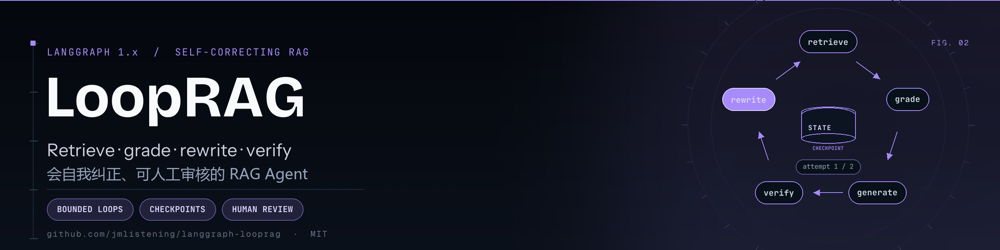
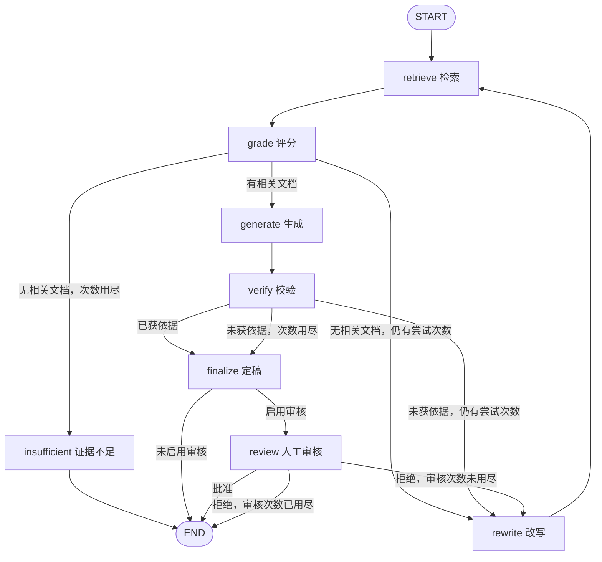

# LoopRAG

<p align="center">
  
</p>

[简体中文](README.zh-CN.md) · [English](README.md)

[](https://github.com/jmlistening/langgraph-looprag/actions/workflows/ci.yml)
[](LICENSE)
[](https://www.python.org/downloads/)
[](https://github.com/langchain-ai/langgraph)
[](#快速开始)

**一个会自我纠正的 RAG 智能体循环 —— LangGraph 1.x、查询改写、相关性评分、答案校验、有限次重试、人工审核。**

LoopRAG 在一个小型本地语料库上回答问题，但它不会"检索一次、生成一次"就结束：先判断召回
的文本块是否相关，不相关就改写查询；生成答案后再对照来源校验；只有校验通过才定稿。每一次
循环都有硬性上限，每个节点的动作都可见，而且完全离线、无需 API Key 即可运行。

<p align="center">
  
</p>

<p align="center"><sub>真实离线运行录制，无需 API Key。</sub></p>

- **真正的自我纠正循环。** 检索 → 评分 → 生成 → 校验；失败时回到查询改写，而不是悄悄返回
  一个不可靠的答案。
- **有限重试与显式校验。** 尝试次数有上限，引用编号会被检查，未通过校验的答案会明确标注
  警告，绝不假装"有依据"。
- **带检查点的人工审核。** LangGraph 的 `interrupt()` 会带着草稿和编号来源暂停图；
  `Command(resume=...)` 可以批准，也可以把循环送回改写节点。

## 图的结构



| 节点 | 职责 |
| --- | --- |
| `retrieve` | 在本地文本块存储上做 BM25 检索；把当前查询写入状态。 |
| `grade` | 对每个召回文本块做相关性评分，并让 `attempt` 加一。 |
| `rewrite` | 根据缺失词、校验反馈或审核反馈构造新查询。 |
| `generate` | 用相关文本块生成带引用的答案（离线为抽取式，在线为模型生成）。 |
| `verify` | 检查引用编号，以及答案中的主张是否被来源支持。 |
| `finalize` | 写入最终答案；校验失败时附带警告。 |
| `insufficient` | 明确返回"证据不足"，绝不编造。 |
| `review` | 可选的 `interrupt()` 人工批准/拒绝节点。 |

## 为什么需要这个循环

一次性 RAG 常以三种方式失败：检索器召回错了文本块；模型凭参数记忆作答而不是依据来源；
答案引用了并不存在的内容。评分可以拦住第一种，校验可以拦住后两种，而改写让检索有机会用
真正缺失的词再试一次。

这个项目**不解决**什么：它不是语义检索器，不提供审计追踪，离线策略是基于词面的规则而不是
语言模型。详见[局限](#局限)。

## 快速开始

```bash
git clone https://github.com/jmlistening/langgraph-looprag.git
cd langgraph-looprag
uv sync
uv run looprag ask "How is the station powered in winter, and what happens during a power emergency?" --offline
```

第一次执行 `ask` 时，程序会自动把 `examples/corpus` 导入 `.looprag/corpus.json`，并打印一行
提示。以下是实际运行输出（终端宽度 110，本机）：

```text
notice: ingested sample corpus from examples/corpus into .looprag/corpus.json
retrieve  4 chunks for query 'How is the station powered in winter, and what happens du...'
grade     4/4 relevant (attempt 1)
generate  answer drafted
verify    grounded
finalize  done
+------------------------------------------------- Answer --------------------------------------------------+
| A dedicated emergency generator, EG-5, is a 5 kilowatt unit in the radio hut. [1] In a total power        |
| emergency, the station manager radios the regional rescue service and all field travel is suspended until |
| power and communications are restored. [1] The year-round team includes a station manager, a power and    |
| facilities engineer, a mechanic, a field safety officer, a data manager, and a cook. [2] The design       |
| principle is simple: store as much energy as possible in the battery bank, use the hydro turbine whenever |
| Kestrel Creek is flowing, and treat diesel as the winter backup rather than the default. [3]              |
+-----------------------------------------------------------------------------------------------------------+
                                  Sources
+-------------------------------------------------------------------------+
| # | source              | title                         | chunk | score |
|---+---------------------+-------------------------------+-------+-------|
| 1 | power-system.md     | Power System                  |     4 | 3.784 |
| 2 | station-overview.md | Northwind Fjord Field Station |     5 | 3.136 |
| 3 | power-system.md     | Power System                  |     0 | 2.997 |
| 4 | power-system.md     | Power System                  |     1 | 2.663 |
+-------------------------------------------------------------------------+
mode offline-heuristic   attempts 1   thread 8b66dd14-a010-4da3-82dd-049e3fc861ac
```

机器可读输出是一个 JSON 对象，写到 stdout；诊断信息写到 stderr：

```bash
uv run looprag ask "How is the station powered in winter?" --offline --json
```

对象包含 `question`、`final`、`grounded`、`insufficient`、`attempts`、`query`、`mode`、
`thread`、`trace`、`sources` 和 `review_round`。

## 配置

没有 Key 时默认离线。在线模式支持任何 OpenAI 兼容的聊天接口；命令行不提供 API Key 参数。

| 环境变量 | 默认值 | 含义 |
| --- | --- | --- |
| `LOOPRAG_API_KEY` | 未设置 | 启用在线模式；未设置时回退读取 `OPENAI_API_KEY`。 |
| `LOOPRAG_BASE_URL` | OpenAI 默认地址 | OpenAI 兼容接口的 base URL。 |
| `LOOPRAG_MODEL` | `gpt-4o-mini` | 聊天模型名称。 |

`--model` 和 `--base-url` 会覆盖环境变量。内置的极简 `.env` 读取器只读取 `LOOPRAG_*` 键，
不覆盖已存在的环境变量，也从不打印值。需要时可以把 `.env.example` 复制为 `.env`；`.env` 已
加入 gitignore。

OpenAI：

```bash
export LOOPRAG_API_KEY="..."          # 不要提交
export LOOPRAG_MODEL="gpt-4o-mini"
uv run looprag ask "What happens during a power emergency?"
```

Ollama（OpenAI 兼容接口；Key 只是占位符）：

```bash
export LOOPRAG_BASE_URL="http://localhost:11434/v1"
export LOOPRAG_API_KEY="ollama"
export LOOPRAG_MODEL="llama3.1:8b"
uv run looprag ask "What happens during a power emergency?"
```

DeepSeek 风格接口：

```bash
export LOOPRAG_BASE_URL="https://api.deepseek.com/v1"
export LOOPRAG_API_KEY="..."
export LOOPRAG_MODEL="deepseek-chat"
uv run looprag ask "What happens during a power emergency?"
```

在线错误会以 `PolicyError` 抛出，并提示可用 `--offline` 重试；不会静默回退。Key 不会出现在
错误或输出里。在线模式会把问题、召回的文本块和提示词发送到你配置的接口。

## 人工审核

`--review` 需要检查点（checkpointer）；CLI 默认使用内存检查点，也可以用 `--sqlite` 使用
SQLite 检查点。图会调用 `interrupt()`，携带草稿、问题、带编号的来源片段、尝试次数和
grounded 标志。

```bash
uv run looprag ask "How does load shedding work during a power emergency?" --offline --review
```

实际 CLI 记录（stdin 用脚本自动回答 `y` 以便复现；输出来自真实运行；省略了 stderr 的
`review checkpoint:` 行）：

```text
+--------------------------------------- Draft for review (round 1) ----------------------------------------+
| If the battery falls below 20 percent and no generator is online, the controller enters emergency mode    |
| and sheds loads in three tiers. [1] Tier 1, which is never shed, covers the Polar Lab freezers, the radio |
| room, the satellite link, the infirmary, and the fuel tank heater. [1] In a total power emergency, the    |
| station manager radios the regional rescue service and all field travel is suspended until power and      |
| communications are restored. [3] The briefing covers weather, sea ice, radio procedure, polar bear        |
| awareness, and the station's power emergency rules. [4]                                                   |
+-----------------------------------------------------------------------------------------------------------+
Question: How does load shedding work during a power emergency?
attempt 1 | grounded=True
[1] power-system.md: 6,000-litre bunded tank beside the powerhouse, and the tank is never allowed below 40
percent between ship deliveries. Waste heat from the generator jacket i...
[2] power-system.md: in 2023. The bank is kept between 20 and 90 percent state of charge to protect cycle
life. ## Winter diesel operation From November to April the station runs...
[3] power-system.md: heater. Tier 2 covers lodge heating and the workshop. Tier 3 covers non-essential
lighting, laundry, and the sauna. A dedicated emergency generator, EG-5, is...
[4] visiting-policy.md: no visitor permits are issued for those windows except for emergency maintenance. ##
Safety briefing and field rules Every visitor completes a 90-minute safe...
Approve? [y/N] +------------------------------------------------- Answer --------------------------------------------------+
| If the battery falls below 20 percent and no generator is online, the controller enters emergency mode    |
| and sheds loads in three tiers. [1] Tier 1, which is never shed, covers the Polar Lab freezers, the radio |
| room, the satellite link, the infirmary, and the fuel tank heater. [1] In a total power emergency, the    |
| station manager radios the regional rescue service and all field travel is suspended until power and      |
| communications are restored. [3] The briefing covers weather, sea ice, radio procedure, polar bear        |
| awareness, and the station's power emergency rules. [4]                                                   |
+-----------------------------------------------------------------------------------------------------------+
                          Sources
+----------------------------------------------------------+
| # | source             | title           | chunk | score |
|---+--------------------+-----------------+-------+-------|
| 1 | power-system.md    | Power System    |     3 | 8.923 |
| 2 | power-system.md    | Power System    |     2 | 3.560 |
| 3 | power-system.md    | Power System    |     4 | 2.200 |
| 4 | visiting-policy.md | Visiting Policy |     2 | 1.993 |
+----------------------------------------------------------+
mode offline-heuristic   attempts 1   thread c4bac2e2-1559-493f-bd5d-6628adb2e76c
```

恢复决策的形状是 `{"approved": bool, "feedback": str}`。缺失或格式错误的决策会按拒绝处理，
反馈为 `No decision provided`。如果还有审核预算，拒绝会把反馈写入 critique 并回到 `rewrite`；
默认 `max_reviews=1` 时，拒绝会直接结束，并在草稿后附加审核说明。把图嵌入自己的程序时，可用
`build_graph(..., max_reviews=N)` 增加轮次。

开始审核前，CLI 会向 stderr 打印
`review checkpoint: thread <id>, checkpointer <path-or-in-memory>`，因此中断的审核总能被
定位。如果 stdin 不是交互式终端，`--review` 会打印待处理的 payload 并以状态码 `3` 退出，而
不是挂起。配合 `--sqlite` 时，待处理的审核会保留在该线程的检查点中，可以用图 API 恢复
（演示 CLI 不提供单独的 resume 命令）：

```python
from langgraph.types import Command

# `graph` 是用同一个 policy、retriever 和 SqliteSaver 编译的图；
# `thread` 是 CLI 打印的线程 ID。
graph.invoke(
    Command(resume={"approved": True, "feedback": ""}),
    {"configurable": {"thread_id": thread}},
)
```

## 线程与持久化

- `--thread ID` 复用带检查点的会话线程；未提供时 CLI 生成 UUID4 并打印。
- 默认检查点是 `InMemorySaver`，只在当前进程内有效，`chat` 用的就是它；进程退出后不会保留。
- `--sqlite PATH` 使用 `SqliteSaver`；会自动创建父目录，并在退出时关闭连接。这是跨进程方案，
  需要 `sqlite` 可选依赖：`uv sync --extra sqlite`。
- `ask` 只问一个问题。`chat` 在同一线程上连续提问，直到 `/exit`，支持 `/trace`、`/sources`、
  `/help`。

```bash
uv run looprag ask "How is the station powered in winter?" --offline \
  --sqlite .looprag/checkpoints.sqlite --thread northwind
uv run looprag ask "What happens during a power emergency?" --offline \
  --sqlite .looprag/checkpoints.sqlite --thread northwind
```

两次提问共享同一个带检查点的线程。只写 `--sqlite` 时默认使用
`.looprag/checkpoints.sqlite`。

## 状态与不变量

```python
class LoopRAGState(TypedDict, total=False):
    question: str
    query: str
    attempt: int
    documents: list[Chunk]
    grades: list[Grade]
    relevant: list[Chunk]
    answer: str
    critique: Critique | None
    grounded: bool
    final: str
    insufficient: bool
    review_round: int
    approved: bool | None
    notice: str | None
    trace: Annotated[list[TraceEvent], operator.add]
```

- 文本块是普通字典（`id`、`source`、`title`、`chunk`、`content`，PDF 可带 `page`，检索时
  附加 `score`），不是 LangChain `Document` 对象，因此检查点始终可 JSON 序列化。
- `trace` 使用可累加的 reducer：每个节点至少返回一个事件。
- `attempt` 从 0 开始，每次调用 `grade` 恰好加一。路由受 `max_attempts` 限制；CLI 另外传入
  `recursion_limit=60` 作为第二道硬预算。
- 不可能无限改写：每次循环都会经过 `grade` 使 `attempt` 增长，grade 和 verify 两条路由都受
  `max_attempts` 约束。
- `insufficient` 和未通过校验的定稿都是显式的；CLI 会给出警告，而不是声称有依据。
- 离线模式只构造 `HeuristicPolicy`，不会发起任何网络请求或 LLM 调用。
- 人工审核必须有检查点：`build_graph` 在 `enable_review=True` 且没有检查点时会拒绝构建；
  审核轮数受 `max_reviews` 限制。

## 测试

```bash
uv sync --extra dev --extra openai --extra sqlite --extra pdf
uv run --no-sync pytest -q
uv run --no-sync ruff check .
uv run --no-sync ruff format --check .
```

所有测试都在离线环境运行，不需要 API Key，也没有网络请求。测试覆盖：分块与稳定 ID、BM25
排序、启发式策略、正常/改写/次数用尽/校验重试路径的精确节点顺序、递归上限、人工审核的批准/
拒绝/interrupt 行为、CLI 退出码（包括非交互 stdin 下的审核）、SQLite 检查点，以及针对发布
文件的隐私扫描。

## 隐私与安全

- 默认离线；除非你配置了 Key 且不加 `--offline`，否则没有任何遥测或网络请求。
- 在线模式会把问题、召回的文本块和提示词发送到所配置的 API。不要用它处理不能分享给该服务商
  的材料。
- LoopRAG 不会把 API Key 写入磁盘，不接受命令行 Key 参数，也不会把 Key 放进错误信息。
  `.env`、`.looprag/`、SQLite 检查点、虚拟环境和缓存均已 gitignore。
- 语料库存储只包含相对来源路径，不包含本机绝对路径。
- 示例语料是虚构的，不包含个人数据。

## 局限

- 离线策略基于词面：停用词、轻量词干、词项覆盖率和 BM25。它确定、可解释，但不是 LLM；当多个
  文档共享问题词时，可能选到弱相关的句子。
- 检索是 BM25，不是语义检索；没有共同词项的改写问法会被漏掉。
- 在线 JSON 解析是防御式的；服务商返回畸形输出时，可能退化为保守评分或"未获依据"的结论。
- 分块按字符而不是 token；离线分词器偏英文。
- 人工审核是演示，不是审计系统：没有身份认证、多用户隔离，也没有检查点之外的审批历史。
- 这是一个作品集规模的项目，不是生产级基础设施。

## 项目结构

```text
langgraph-looprag/
├── .env.example
├── .gitignore
├── .github/workflows/ci.yml
├── assets/banner.png
├── assets/demo.gif
├── LICENSE
├── README.md
├── README.zh-CN.md
├── pyproject.toml
├── uv.lock
├── examples/corpus/          # 五份虚构的 Northwind Fjord 文档
├── src/looprag/
│   ├── cli.py
│   ├── config.py
│   ├── corpus.py
│   ├── graph.py
│   ├── heuristic.py
│   ├── llm_policy.py
│   ├── output.py
│   ├── policy.py
│   └── state.py
└── tests/
    ├── test_cli.py
    ├── test_corpus.py
    ├── test_graph.py
    ├── test_heuristic.py
    ├── test_human_review.py
    └── test_privacy.py
```

## 许可证

MIT，2026，HappyJM。见 [LICENSE](LICENSE)。
